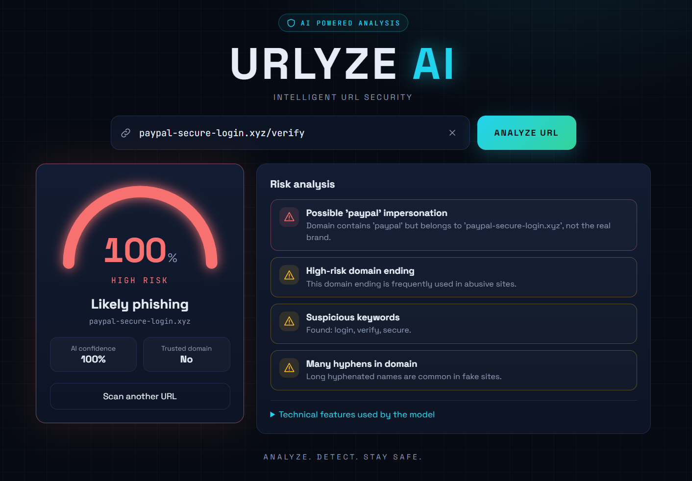
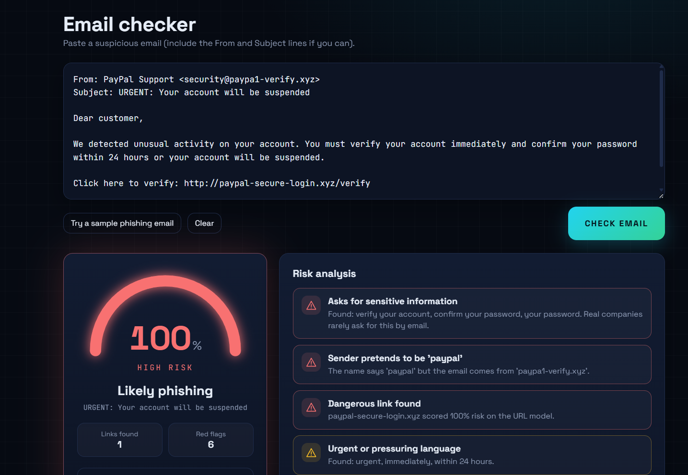

# URLYZE AI

**Intelligent Phishing URL & Email Detection with Risk Analysis**
*Analyze. Detect. Stay Safe.*

URLYZE AI checks a website URL or a pasted email and returns a **risk score (0-100)**, a verdict, and a
list of **human-readable reasons** explaining the result. URL scores come from a trained machine-learning
model that the web app calls live (no hard-coded results). Users sign up and log in, and each user's scan
history is saved to their account.




## Features

- **URL scanner** with animated radar, risk meter, verdict (Low / Medium / High) and explainable risk factors
- **Email checker**: paste a suspicious email and get a risk score; every link inside it is also scored by the URL model
- **Login and sign-up** with hashed passwords and signed session tokens
- **Per-user scan history** stored in a SQLite database
- **Dashboard** with model metrics, model comparison, confusion matrix, ROC curves and feature importance
- **Light and dark mode** (remembered between visits)
- **Responsive design**: desktop sidebar, mobile bottom tab bar
- REST API with automatic interactive docs

## Tech stack

| Part | Technology |
|------|------------|
| ML | Python, pandas, scikit-learn, XGBoost |
| Backend | FastAPI, Uvicorn |
| Database | SQLite (Python standard library) |
| Frontend | React, Vite |

## How it works

1. **Feature extraction** (`ml/src/features.py`): lexical features are computed from the URL string only
   (length, dots, hyphens, IP host, subdomains, risky TLD, suspicious words, entropy, ...). No network calls
   are made, so scans are fast, and the same code is used for training and prediction.
2. **Model**: five models were trained and compared; the best by F1-score (XGBoost) is saved.
3. **URL scan** (`backend/analyzer.py`): `/predict` extracts features, runs the model, adds rule-based
   explanations, and applies a small trusted-domain list so well-known sites are not false-flagged.
4. **Email check** (`backend/email_analyzer.py`): a hybrid of
   - rule-based text analysis (urgent wording, requests for passwords or payment details, prize lures,
     threats, generic greetings, attachment tricks, shouting),
   - sender analysis (a brand name in the sender name that does not match the sender's domain), and
   - link analysis (every link is scored by the trained URL model).
5. **Accounts** (`backend/auth.py`, `backend/db.py`): passwords are hashed with PBKDF2-HMAC-SHA256
   (random salt, 600,000 iterations); login returns a signed token (JWT format, HS256, 12-hour expiry);
   5 failed logins per email within 5 minutes are blocked temporarily.
6. **Frontend** (`frontend/`): the React app signs the user in, sends URLs and emails to the API, and
   renders the results.

## Datasets

- **PhiUSIIL Phishing URL Dataset** (UCI Machine Learning Repository)
- **Phishing Site URLs** (Kaggle)

Both are merged after cleaning and de-duplication. Datasets are not included in this repository.

## Results (URL model)

Evaluated on a hold-out set of unseen **domains** (the split is grouped by hostname, so the same
domain never appears in both train and test).

| Model | Accuracy | Precision | Recall | F1 | ROC-AUC |
|-------|---------:|----------:|-------:|---:|--------:|
| **XGBoost** | 0.8921 | 0.8913 | 0.7364 | 0.8065 | 0.9339 |
| Random Forest | 0.8783 | 0.7991 | 0.8032 | 0.8012 | 0.9276 |
| Decision Tree | 0.8482 | 0.7359 | 0.7842 | 0.7593 | 0.8991 |
| Gradient Boosting | 0.8595 | 0.8918 | 0.6145 | 0.7276 | 0.9041 |
| Logistic Regression | 0.8109 | 0.6972 | 0.6730 | 0.6849 | 0.8468 |

Confusion matrix of the best model on 143,516 test URLs: 95,764 legitimate URLs correctly passed,
3,934 false alarms, 11,552 phishing URLs missed, 32,266 phishing URLs caught.

### An honest note about accuracy

The first training run scored about **99.8%**, but failed on real URLs: it flagged `github.com` and
`wikipedia.org` as phishing. Feature importance showed it had learned dataset shortcuts
(`path_length`, `is_https`, `www`), because legitimate URLs in that dataset were almost all bare
`https://www.` homepages. To fix this we:

- removed the scheme and `www.` before measuring features,
- removed `is_https` and `has_www` from the model's inputs,
- merged a second dataset with different formatting, and
- split train/test by domain.

Accuracy fell to about 89%, but the model now behaves sensibly on real URLs.

## Limitations

- The URL model sees only the URL text, not page content, so some phishing URLs look normal
  (phishing recall is about 74%).
- The email checker is rule-based plus the URL model; it is not a trained text classifier, so unusual
  phishing wording can slip through and some legitimate security notices may score as medium risk.
- The trusted-domain list is small and hand-made.
- Login has no email verification or password reset, and the session token is kept in the browser's
  local storage. This is suitable for a project demo, not for production.
- Scan results are a risk estimate, not a guarantee. Do not rely on them as the only security check.

## Project structure

```
urlyze-ai/
  ml/
    src/            features.py, prepare_data.py, train.py, sanity_check.py
    data/           raw/ and processed/ (not committed)
    models/         trained model + metadata
    reports/        charts and metrics
  backend/
    main.py         API routes
    analyzer.py     URL analysis
    email_analyzer.py  email analysis
    auth.py         password hashing, tokens, login limits
    db.py           SQLite storage (database file created in backend/data/)
  frontend/         React + Vite app
  docs/             documentation and screenshots
  requirements.txt
```

## Setup

Requirements: Python 3.10+, Node.js 18+.

```bash
# 1. Python environment
python -m venv venv
source venv/Scripts/activate        # Windows (Git Bash). macOS/Linux: source venv/bin/activate
pip install -r requirements.txt
pip install -r backend/requirements.txt

# 2. Train the model (put the two dataset CSVs in ml/data/raw/ first)
cd ml/src
python prepare_data.py --input ../data/raw/PhiUSIIL_Phishing_URL_Dataset.csv ../data/raw/phishing_site_urls.csv --legit-label 1 good
python train.py
python sanity_check.py
cd ../..

# 3. Run the backend  (http://127.0.0.1:8000/docs)
cd backend
uvicorn main:app --reload

# 4. Run the frontend in a second terminal  (http://localhost:5173)
cd frontend
npm install
npm run dev
```

Open http://localhost:5173, create an account, and start scanning.

## API

Public: `GET /health`, `GET /model-info`, `GET /reports/<chart>.png`, `POST /auth/register`, `POST /auth/login`.

Requires login (`Authorization: Bearer <token>`): `GET /auth/me`, `POST /predict`, `POST /email-check`,
`GET /history`, `DELETE /history`.

```json
POST /predict      { "url": "http://paypal-secure-login.xyz/verify" }
POST /email-check  { "text": "From: ...\nSubject: ...\n\nEmail body..." }
```

Both return the risk score, level, verdict, and a `factors` list of explanations.

## Author

Ritika Singh
cse(aiml)-2308021530018
